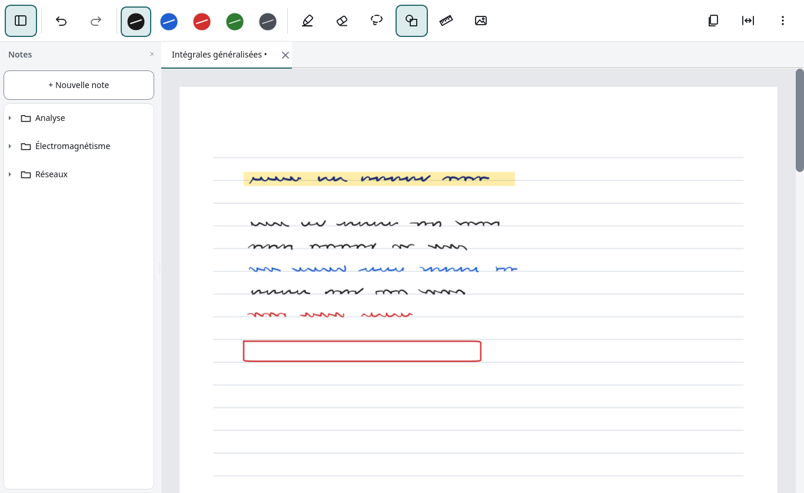
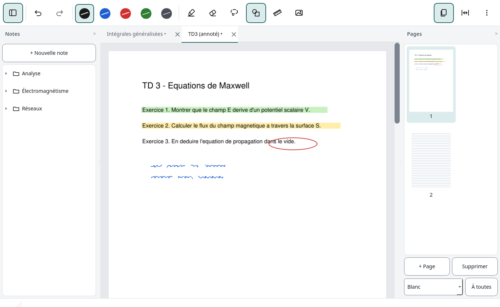
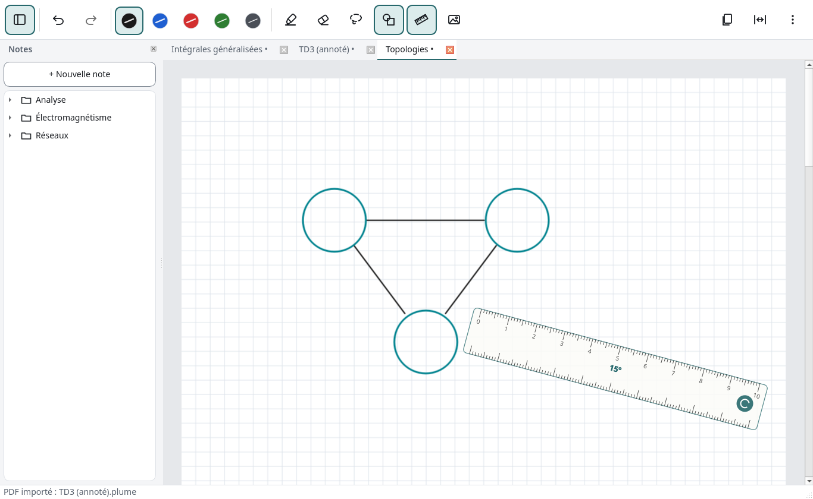
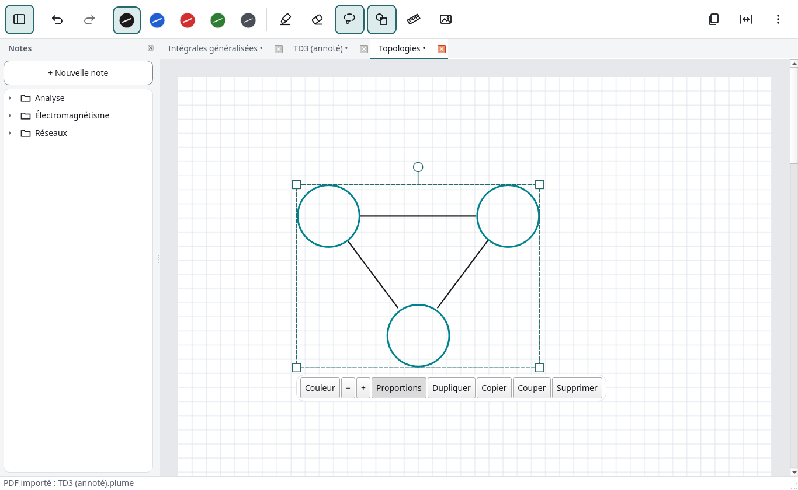
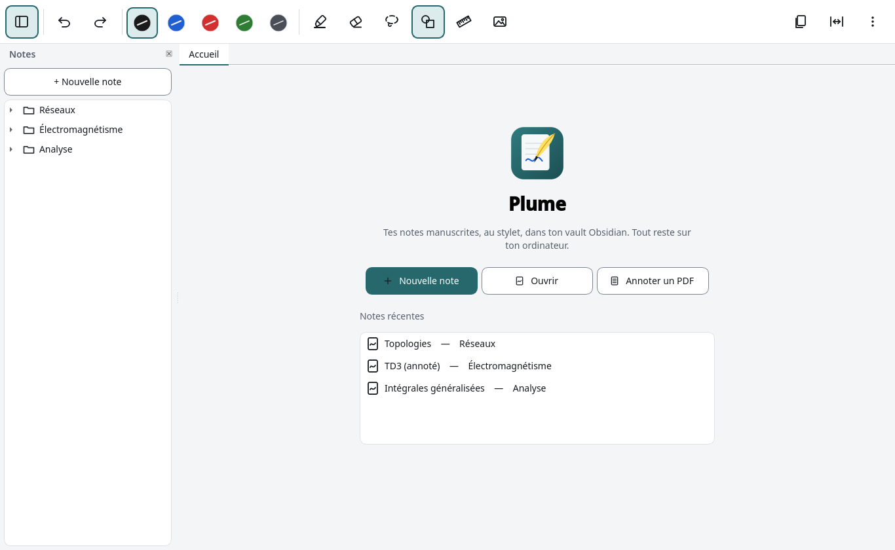

<p align="center"></p>

<h1 align="center">FNote</h1>

<p align="center"><b>Tes cours à la main, au stylet, comme sur une feuille — sous Linux.</b><br>
Prise de notes manuscrites et annotation de PDF pour Fedora / GNOME Wayland. 100 % hors ligne, rangé dans ton vault Obsidian.</p>

<p align="center"></p>

## Pourquoi FNote

Les applis de notes libres sous Linux marchent, mais l'encre traîne derrière le stylet et le curseur de la souris reste affiché pendant qu'on écrit : on n'a pas l'impression d'écrire sur du papier. FNote est construit autour de ces deux points.

- **L'encre suit la pointe.** Seul le dernier segment est redessiné pendant le tracé, les traits finis sont « cuits » dans une image par page, aucun point du stylet n'est fusionné. Épaisseur selon la pression, lissage sans retard.
- **Pas de curseur pendant l'écriture.** Il disparaît dès que le stylet approche de l'écran ; un petit point discret indique où tu vas écrire. Il revient quand tu touches la souris.
- **La main posée ne dessine pas.** Le tactile est ignoré tant que le stylet est proche. Un doigt fait défiler, deux doigts zooment.
- **Tes fichiers restent à toi.** Une note = un fichier `.fnote` dans ton vault, et (au choix) un `NomDeLaNote.pdf` à côté, prêt pour `![[NomDeLaNote.pdf]]` dans Obsidian. Aucun compte, aucun réseau.

## Ce que tu peux faire

| | |
|---|---|
| ✍️ **Stylos** | plume (pression), bille, crayon ; 5 stylos favoris en un clic ; 16 encres + tes couleurs + récentes ; sélecteur HSV / RGB / HEX |
| 🖍️ **Surligneur** | passe toujours *sous* l'encre, opacité uniforme même en repassant, option « surligneur droit », 5 couleurs |
| 🧽 **Gomme** | trait entier ou partielle, taille réglable, « surligneur seulement » ; bouton latéral du stylet maintenu = gomme |
| ➰ **Lasso** | déplacer, redimensionner (proportions), pivoter, recolorer, épaissir, copier/couper/coller, dupliquer |
| ⬭ **Formes** | trace un cercle, un rectangle, une flèche… et garde le stylet immobile une demi-seconde : la forme devient parfaite |
| 📏 **Règle** | graduée en cm, pivotable aux deux doigts, aimantée à 0/15/30/45/90° ; le trait se colle à son bord |
| 📄 **PDF** | annote tes sujets de TD et polys, insère des pages vierges pour tes calculs, exporte en PDF vectoriel (texte d'origine sélectionnable) |
| 🖼️ **Images** | insère, colle une capture d'écran (Ctrl+V), glisse-dépose, recadre |
| 🗂️ **Organisation** | panneau du vault, dossiers, renommer, déplacer, corbeille ; plusieurs notes en onglets ; fonds blanc / ligné / quadrillé / pointillé |

<p align="center">


</p>
<p align="center">


</p>

## Installation (Fedora)

```bash
git clone https://github.com/MaXelDev/fnote.git
cd fnote
./install.sh
```

FNote apparaît ensuite dans les applications GNOME (et `fnote` dans le terminal). Il faut Python 3.12 ou plus (`sudo dnf install python3`). L'installation télécharge PySide6, PyMuPDF et NumPy ; **l'application, elle, ne se connecte jamais à Internet**.
Désinstaller : `./uninstall.sh` (tes notes et tes paramètres sont conservés).

## Premiers pas

1. Au premier lancement, choisis ton dossier de notes (ton vault Obsidian par exemple).
2. **Nouvelle note** (Ctrl+N) ou **Annoter un PDF** depuis l'accueil — ou double-clique un PDF dans le panneau des notes.
3. Écris. Tout est enregistré automatiquement quelques secondes après ton dernier trait.

Si le stylet ne se comporte pas comme prévu : *Menu → Aide → Diagnostic du stylet* (ou `fnote --debug-tablet`) affiche en direct la pression, l'inclinaison, les boutons et la proximité.

## Raccourcis

| Touche | Action | Touche | Action |
|---|---|---|---|
| 1 à 5 | stylos favoris | Ctrl+Z / Ctrl+Y | annuler / rétablir |
| P | stylo | Ctrl+C / X / V | copier / couper / coller |
| H | surligneur | Ctrl+D, Suppr | dupliquer, supprimer la sélection |
| E | gomme | Ctrl+I | insérer une image |
| L | lasso | Ctrl+Maj+I, Ctrl+E | importer / exporter un PDF |
| R | règle | Ctrl+molette, Ctrl+0 | zoom, ajuster à la largeur |
| F9 | panneau des notes | F11 | plein écran |

Un **second appui** sur l'outil actif ouvre ses réglages (couleur, épaisseur, pointe…). *Menu → Fichier → Paramètres* (Ctrl+,) pour la sensibilité à la pression, le bouton du stylet, le fond par défaut, etc.

## Développement

```bash
python3 -m venv .venv && .venv/bin/pip install -e ".[dev]"
git config core.hooksPath .githooks   # pytest avant chaque commit
.venv/bin/pytest -q                   # 120+ tests, sans matériel
.venv/bin/fnote --debug-perf          # fps et temps de rendu à l'écran
```

Architecture (MVC), format de fichier et choix techniques : [`docs/replica/architecture.md`](docs/replica/architecture.md), [`docs/adr/0001-stack.md`](docs/adr/0001-stack.md), plan de tests [`docs/tests.md`](docs/tests.md).

## Licence

Code de FNote sous licence **MIT**. FNote s'appuie sur PySide6 (LGPL-3.0), NumPy (BSD) et **PyMuPDF (AGPL-3.0)** : toute version *distribuée* avec PyMuPDF est soumise aux conditions de l'AGPL-3.0. Pour un usage personnel, rien ne change.

*Mots-clés : notes manuscrites, stylet, tablette graphique, Wacom, écran tactile, PDF, annotation, surligneur, Linux, Fedora, GNOME, Wayland, Obsidian, hors ligne, étudiant.*
